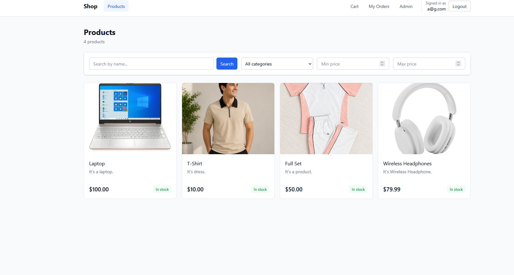
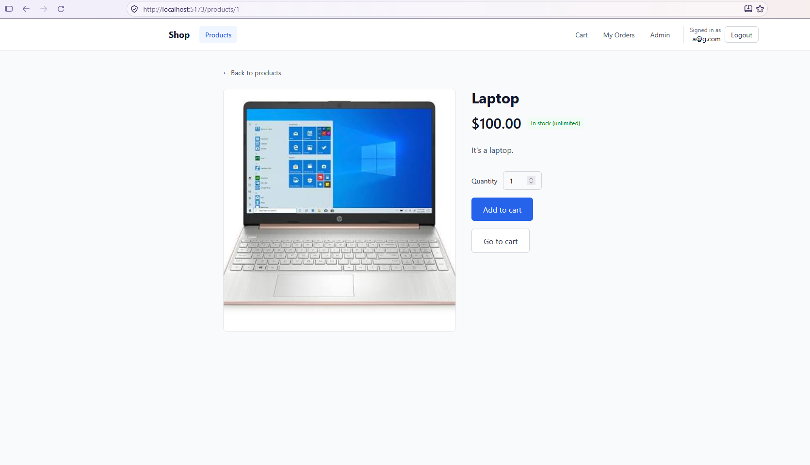
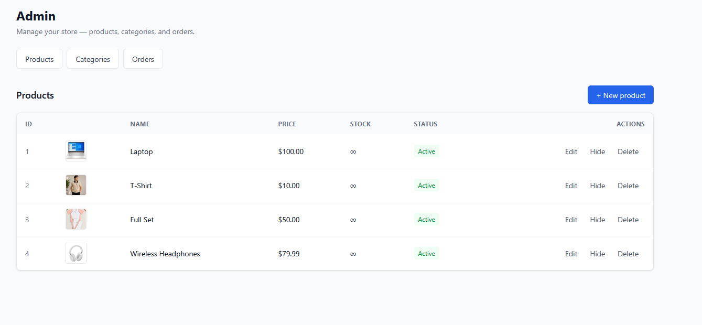
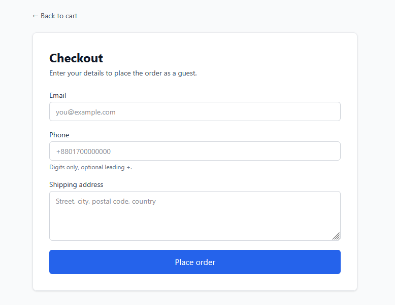
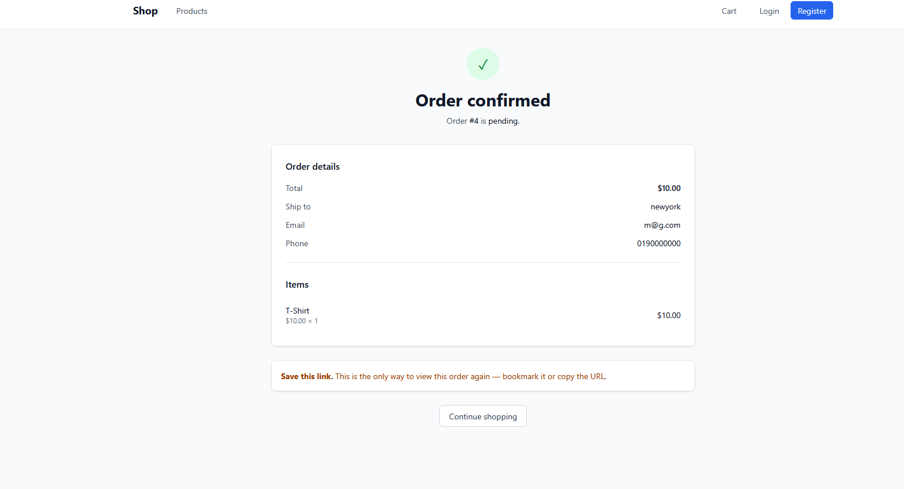
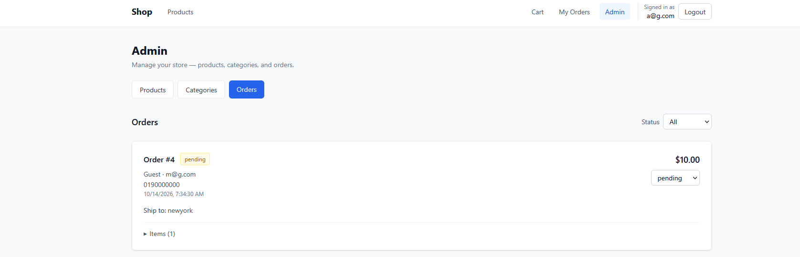

# Full-Stack E-Commerce & Inventory Management System


A production-style e-commerce backend and storefront with JWT authentication, role-based access control, inventory management, guest checkout, and admin tooling.

Built as a portfolio project to demonstrate full-stack engineering: clean API design, relational data modeling, transactional integrity, security best practices, and automated testing.

## Screenshots

### Product catalog


### Product detail


### Admin — add product


### Cart & checkout


### Order confirmation


### Admin — orders


## Features

- **Authentication & Roles** — JWT-based auth, bcrypt password hashing, `admin` / `customer` roles enforced server-side
- **Product Catalog** — CRUD for products and categories, search, category/price filters, pagination
- **Product Images** — Admin-only signed uploads to Cloudinary; the frontend never sees the API secret
- **Inventory Management** — Stock tracking with per-order decrements, unlimited-stock flag for digital goods, "out of stock" states
- **Shopping Cart** — Per-user carts, add/update/remove items, stock validation on every change
- **Checkout & Orders** — Atomic order creation (snapshot pricing + decrement stock + clear cart in one transaction), order history, status workflow (`pending → paid → shipped → delivered` / `cancelled`)
- **Guest Checkout** — Order without an account using a client-held token; retrievable via confirmation link
- **Admin Dashboard** — Manage products, categories, order statuses; view all orders including guest orders
- **API Validation** — Pydantic schemas on every endpoint; 400/401/403/404 for every failure mode
- **Interactive Docs** — Auto-generated Swagger / OpenAPI at `/docs`

## Tech Stack

| Layer | Technology |
|---|---|
| Frontend | React 19, React Router, Vite, Tailwind CSS |
| Backend | FastAPI, SQLAlchemy 2, Pydantic v2 |
| Database | PostgreSQL 16, Alembic migrations |
| Auth | JWT (python-jose), bcrypt (passlib) |
| Media | Cloudinary (signed uploads) |
| Tooling | `uv`, Docker, GitHub Actions |

## Project Structure

```
ecommerce-fullstack/
├── backend/
│   ├── app/
│   │   ├── core/          # Security, JWT, password hashing
│   │   ├── models/        # SQLAlchemy models
│   │   ├── schemas/       # Pydantic request/response schemas
│   │   ├── routers/       # API endpoints
│   │   ├── config.py      # Settings loaded from env
│   │   ├── database.py    # Engine, session, Base
│   │   └── main.py        # FastAPI app + CORS + routers
│   └── tests/             # pytest + httpx test suite
├── frontend/
│   └── src/
│       ├── api/           # Fetch wrappers (auth + Cloudinary)
│       ├── components/    # Navbar, UI primitives, guards
│       ├── context/       # AuthContext
│       └── pages/         # Products, Cart, Checkout, Admin, ...
├── alembic/               # DB migrations
├── .github/workflows/     # CI (tests on every push)
├── docker-compose.yml
└── README.md
```

## Getting Started

### Prerequisites

- Python **3.12+**
- Node.js **20.19+** or **22.12+**
- PostgreSQL **16+**
- [`uv`](https://docs.astral.sh/uv/) (Python package manager)
- A [Cloudinary](https://cloudinary.com) account (free tier is fine)

### 1. Clone

```bash
git clone https://github.com/safayetsawom/ecommerce-fullstack.git
cd ecommerce-fullstack
```

### 2. Backend Setup

```bash
uv sync

psql -U postgres -c "CREATE DATABASE ecommerce_db;"
psql -U postgres -c "CREATE DATABASE ecommerce_test;"

cp backend/.env.example backend/.env
# Edit backend/.env and fill in:
#   DATABASE_URL, SECRET_KEY,
#   CLOUDINARY_CLOUD_NAME, CLOUDINARY_API_KEY, CLOUDINARY_API_SECRET

uv run alembic upgrade head
uv run fastapi dev backend/app/main.py
```

API: **http://127.0.0.1:8000** — Swagger: **http://127.0.0.1:8000/docs**

### 3. Frontend Setup

```bash
cd frontend
npm install
npm run dev
```

Frontend: **http://localhost:5173**

### 4. Create an Admin User

1. Register via the UI or `POST /auth/register` in Swagger
2. Promote in the DB:

```bash
psql -U postgres -d ecommerce_db -c "UPDATE users SET role='admin' WHERE email='your@email.com';"
```

3. Log out and back in — the **Admin** link appears in the navbar

## Running Tests

```bash
uv run pytest
```

23 tests covering authentication, role enforcement, product CRUD and filtering, cart behavior, guest flow, checkout, stock decrements, and order authorization.

Every push runs the same suite via GitHub Actions.

## Docker

```bash
docker compose up --build
```

- Frontend: http://localhost:3000
- Backend: http://localhost:8000
- Postgres: localhost:5433

## API Overview

| Method | Endpoint | Auth | Description |
|---|---|---|---|
| POST | `/auth/register` | — | Create account |
| POST | `/auth/login` | — | Get JWT token |
| GET | `/auth/me` | user | Current user |
| GET | `/categories/` | — | List categories |
| POST | `/categories/` | admin | Create category |
| GET | `/products/` | — | List (search, filter, paginate) |
| POST | `/products/` | admin | Create product |
| PATCH | `/products/{id}` | admin | Update product |
| DELETE | `/products/{id}` | admin | Delete product |
| GET | `/uploads/signature` | admin | Get Cloudinary upload signature |
| POST | `/cart/guest` | — | Create guest cart token |
| GET | `/cart/` | user/guest | View cart |
| POST | `/cart/items` | user/guest | Add item |
| PATCH | `/cart/items/{id}` | user/guest | Update quantity |
| DELETE | `/cart/items/{id}` | user/guest | Remove item |
| POST | `/orders/` | user | Checkout |
| POST | `/orders/guest` | — | Guest checkout |
| GET | `/orders/me` | user | Order history |
| GET | `/orders/` | admin | All orders |
| PATCH | `/orders/{id}/status` | admin | Update status |

Full schema at `/docs`.

## Design Notes

A few decisions worth calling out:

- **Price and product name are snapshotted on each `OrderItem`.** If a product is renamed or its price changes, past orders stay accurate.
- **Checkout runs in a single transaction.** Creating the order, order items, decrementing stock, and clearing the cart either all succeed or all roll back.
- **Stock is re-validated at checkout.** A cart can sit for days; verifying at the moment of purchase prevents overselling.
- **Ownership is enforced at the query level.** Every cart and order query includes `user_id = current_user.id` — a user cannot reach another user's data even with a guessed ID.
- **Guest orders use a token-based confirmation URL.** The token is the only credential, treated like a password.
- **Cloudinary uploads are signed server-side.** Only authenticated admins can obtain a signature; the API secret never leaves the backend.
- **Products with order history can't be hard-deleted.** The API returns a 400 and the admin UI offers a "Hide" action (soft delete via `is_active`) instead.

## License

MIT